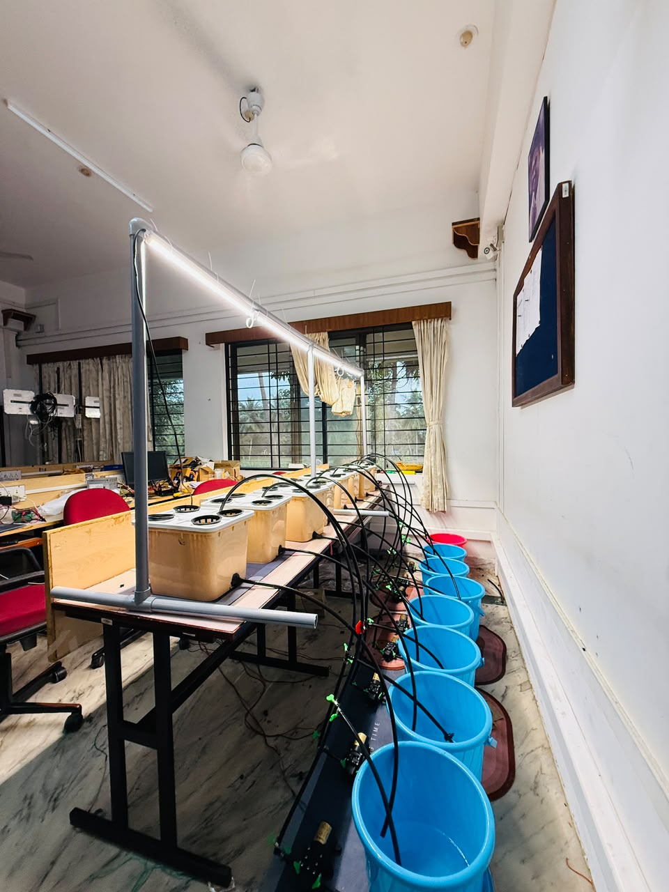
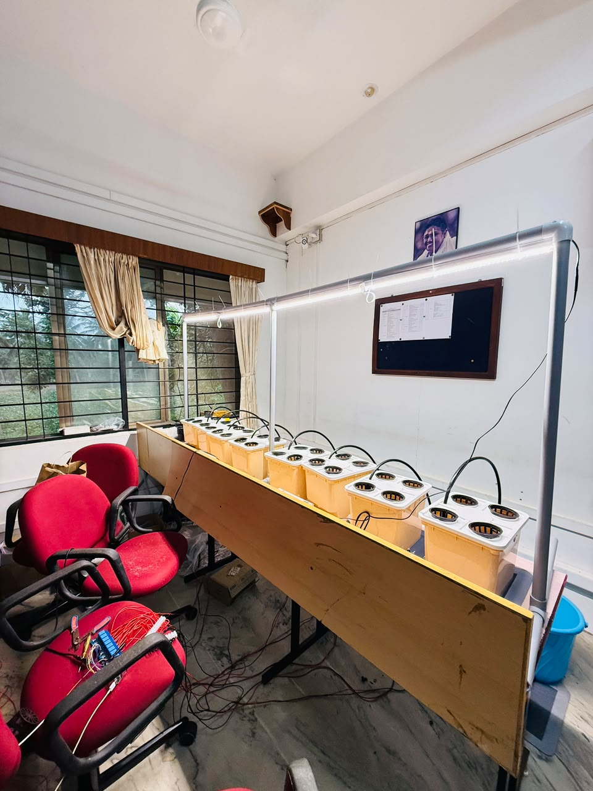
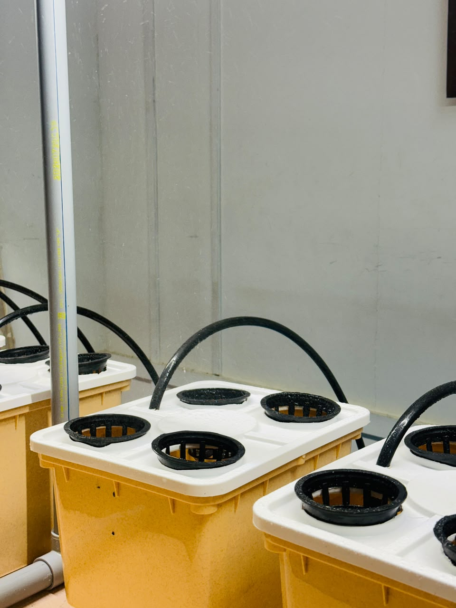

# Smart Aeroponics System

## About

We are investigating how nutrient deficiencies develop and appear over time in fenugreek (*Trigonella foenum-graecum*) grown in an indoor aeroponic environment. By connecting controlled nutrient treatments with repeated plant images and experimental observations, this research aims to support more systematic study of plant health and visual symptom progression. The long-term goal is a practical system that can identify nutrient deficiencies from plant images and run on an edge device.

## Research objectives

- Study fenugreek under controlled nitrogen (N), phosphorus (P), and potassium (K) deficiency conditions.
- Document changes in leaf appearance and plant health over time.
- Build a structured, treatment-labelled image dataset with timestamps and experimental context.
- Explore computer-vision and machine-learning methods for deficiency analysis and temporal progression.

## Experimental setup

  
  
  

## Dataset and analysis

The intended dataset will organize plant images by treatment and capture time, alongside available experimental observations. This structure is intended to enable:

- **Computer vision:** investigate visible deficiency-related features in leaf images.
- **Machine learning:** explore classification and plant-health analysis once suitable labelled data are collected.
- **Temporal analysis:** study how visible symptoms change across successive observations.
- **Edge deployment:** work toward running a deficiency-identification model locally on an edge device. This is a future objective, not a currently documented capability.

Dataset, model, and detection performance have not yet been documented in this organization.

## Research direction

The intended progression is to collect and label images from controlled nutrient treatments, investigate models for identifying deficiencies, and evaluate whether a suitable model can be deployed for on-device inference. Model selection, edge hardware, and deployment readiness remain to be determined.

## Featured repositories

- **Aeroponic testbed and experiment records** — [Experiments](https://github.com/AKASA-Lab/experiments)
- **Fenugreek image dataset and collection workflow** — [Dataset](https://github.com/AKASA-Lab/datasets)
- **Nutrient-deficiency image analysis** — [Model](https://github.com/AKASA-Lab/ai-services)

## Contributors and collaboration

Contributors shown in the organization-members image, along with Abhinav G:

- Abhinav G
- [Adwaith Arun](https://github.com/adwaith5002)
- ARYAPRAMESH
- [Karthik Vishal](https://github.com/karthikvishal-s)
- [Shibi Krishna](https://github.com/Shibi404)

We welcome collaboration in controlled-environment agriculture, plant science, embedded sensing, computer vision, and machine learning. Reach out to:  adwaitharun2005@gmail.com
